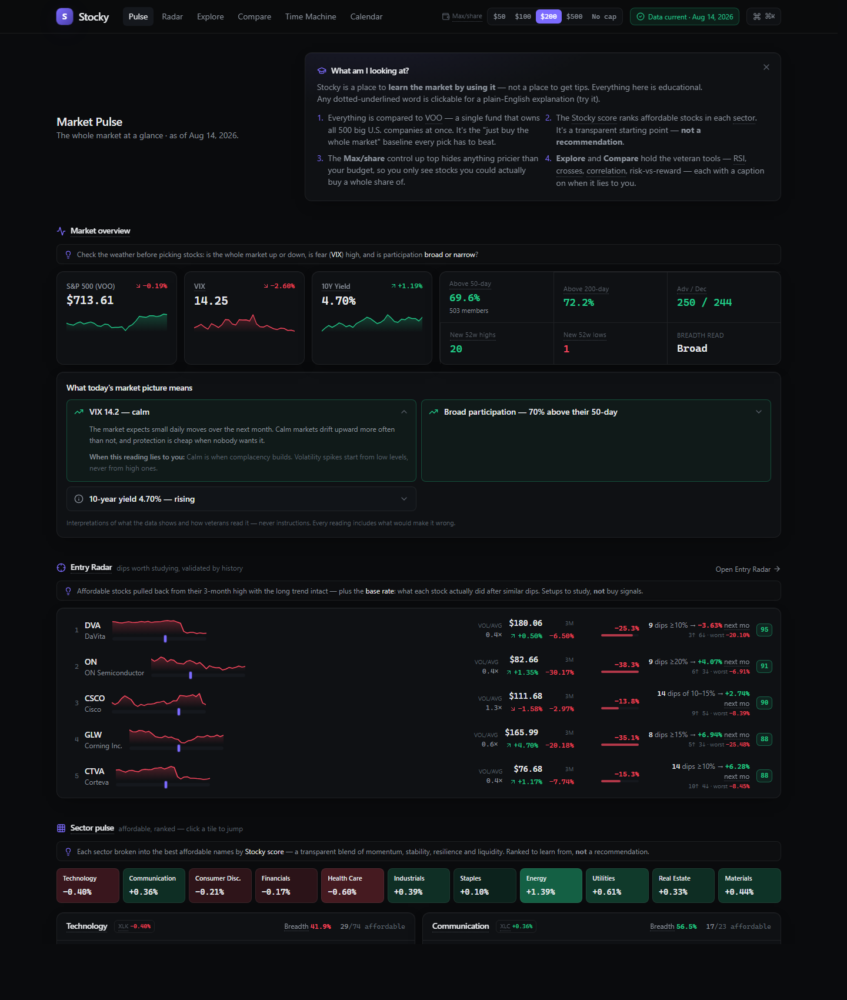

> **© 2026 Chiranjeev (@chiranr19) — All Rights Reserved.** This project is **source-available for viewing only**; it is *not* open source. No copying, reuse, modification, deployment, or redistribution of any part of it (or its underlying ideas) without prior written permission — see [LICENSE](./LICENSE) and [SIGNATURE](./SIGNATURE). Prospective employers and collaborators are welcome to read the code.  ·  authorship sigil `5FEN·NYU3·G7KN·XVL7`

# Stocky 📈

**A stock-market learning dashboard: pro analysis views with beginner captions.**

[](https://github.com/chiranr19/stocky/actions/workflows/ci.yml)
[](https://github.com/chiranr19/stocky/actions/workflows/daily-digest.yml)


**Full S&P 500 ingestion · base-rate validated entry signals · deterministic
insight engine · zero-LLM daily digest**

Stocky shows you the tools a market veteran actually uses — breadth, RSI, golden
crosses, risk-vs-reward maps, correlation, candlesticks — and pins a plain-English
note to every one of them: **what it is, why vets watch it, and when it lies to
you**. The full S&P 500 is screened down to stocks you can actually afford
(default ≤ $200/share), and everything is benchmarked against the boring
alternative: just buying VOO.

The bet behind it: most retail tools either dump raw indicators on you or hide
everything behind a black-box "signal." Stocky does neither. Every ranking is a
published formula, every claim about the future is a **base rate over labelled
historical analogues** with its sample size and worst case attached, and every
chart carries a caption saying what would make its reading wrong.

> ⚠️ Educational tool for building intuition about risk, volatility, and
> opportunity cost. **Not financial advice.**



## What's inside

| Page | What it does |
| --- | --- |
| **Pulse** `/` | VOO · VIX · 10-yr yield + market breadth, Entry Radar preview, sector-by-sector **affordable shortlists** ranked by a transparent score, movers, watchlist |
| **Entry Radar** `/radar` | Affordable stocks in a **pullback**, ranked by a transparent entry score (depth · trend · RSI · quality) and **validated against each stock's own history**: N similar past dips → median next-month move, win rate, worst case. Setups to study — never buy signals |
| **Watch-outs** `/watchouts` | The mirror of the Radar: stocks carrying **named hazards** — falling knives, value traps, names that paid you in volatility instead of returns — ranked by severity, each chip explaining what the pattern means and how vets treat it. A teaching list, not a sell list |
| **Explore** `/explore` | Risk-vs-reward scatter (all 500 names), scanners (gainers/losers/volume/52-week highs·lows/gaps), golden/death crosses, RSI extremes |
| **Compare** `/compare` | Up to 3 tickers vs VOO: normalized growth, stats, correlation matrix, return distributions |
| **Deep dive** `/stock/…` | Candlesticks + MA50/200 + volume + RSI, score breakdown, fundamentals, distribution vs VOO |
| **Time Machine** `/time-machine` | "What if I'd put $500 in NVDA on that date?" vs VOO — with the scariest drawdown highlighted |
| **Calendar** `/calendar` | Upcoming earnings + macro dates (Fed, CPI, jobs) |

**The teaching layer is the point:** ~35 glossary terms, and every metric label in
the app is clickable → a popover explains it like you're new (because the builder
was). The **Stocky score** (Momentum 40 · Stability 30 · Resilience 20 ·
Liquidity 10) is fully transparent — a starting point for learning, never a
recommendation. A freshness badge proves how current the data is against the
NYSE calendar.

**Good picks *and* bad picks.** Seeing why a setup is bad is what makes the good
ones legible, so the same engine names both: strengths (trend intact,
constructive pullback, calm compounder) and hazards (falling knife, value trap,
paid-in-volatility, overextended, thinly traded). Every stock page shows both
columns; the dashboard puts the Entry Radar and the Watch-outs list back to
back. Risk flags follow a stock everywhere — a high entry score can never hide a
hazard.

**The reading layer** answers the question a beginner actually has in front of a
chart — *the line is going up, is that good or is that risky?* Every stock page
and the market overview carry plain-English readings, each one saying what the
data shows, what a veteran does with it, and **what would make that reading
wrong**. Tones are limited to constructive / caution / neutral: interpretations,
never instructions (enforced by a test that fails on advice-like phrasing).

## Daily email digest

A GitHub Actions cron (weekdays, after the US close) refreshes the data and
emails you the day's picture — so the dashboard reaches your phone with the
laptop off. Two sections: **At a glance** (market read, #1 setup, #1 watch-out)
and **The details** (full radar + watch-out tables with echo stats, movers, the
week's calendar), plus the interactive snapshot as an attachment.

**No LLM is involved anywhere in the digest.** Every sentence is assembled by
deterministic templates from values the tested engines computed — the same
readings, flags and base rates the app shows. The footer names the data source
and as-of date, and a test suite fails the build on advice-like phrasing or
fabricated numbers.

One-time setup (only you can do this — it needs your Google account):

```bash
gh secret set GMAIL_USER && gh secret set GMAIL_APP_PASSWORD && gh secret set DIGEST_TO
```

`GMAIL_APP_PASSWORD` is a 16-character [app password](https://myaccount.google.com/apppasswords)
(requires 2-Step Verification), **not** your Google password. Until the secrets
exist the workflow still runs green and prints these instructions instead of
failing. Trigger it by hand from the Actions tab → *Daily Digest* → *Run
workflow*. Preview it locally with `python backend/scripts/build_digest.py`.

## Under the hood

| | |
|---|---|
| **Data layer** | Idempotent, range-aware ingestion into an embedded **DuckDB** columnar store — PK upsert so re-running never duplicates, `[covered_start, covered_end]` tracking so an older backtest date triggers a targeted back-fill. ~5.5 years × 503 tickers ≈ **700k daily bars**, warmed on a background thread in priority order so the dashboard is usable in seconds. |
| **Analytics** | Vectorized pandas/NumPy: **Wilder RSI**, moving-average crossovers, annualized realized volatility, max-drawdown, rolling correlation matrices, return histograms. Pure functions in `services/metrics.py`, unit-tested against hand-computed fixtures. |
| **Ranking** | **Cross-sectional percentile scoring** with mid-rank tie handling — stocks are graded against their sector peers, not absolute thresholds. Every weight is a named constant surfaced in the UI. |
| **Entry Radar** | The interesting part: for each pullback, find every **historical analogue** in that stock's own past (same depth bucket, same trend regime), measure realized forward returns, and report the **base rate** — N, median, win rate, worst case. Tiered matching widens the bucket stepwise when the exact sample is thin, and labels which tier it used. |
| **Confidence model** | A sample isn't trusted on size alone — **regime spread** matters, so confidence requires episodes across ≥3 distinct calendar years. Nine cases from one bull run is labelled *thin*, not *strong*. |
| **Insight engine** | Deterministic rules mapping metrics → plain-English readings and **named risk/strength patterns** (falling knife, value trap, paid-in-volatility, calm compounder…). A CI test fails the build on advice-like phrasing — the no-advice policy is **enforced, not aspirational**. |
| **Performance** | Single batched `WHERE ticker IN` scan + groupby (**2.69s → 0.47s** over 700k rows), generation-keyed memoization, GZip (206 KB → 53 KB), and a **stale-while-revalidate** client cache with in-flight dedupe. |
| **Automation** | GitHub Actions cron warms data, audits quality, builds and emails the digest — with the DuckDB file cached between runs so daily jobs fetch increments instead of re-downloading the universe. |

## Stack

`backend/` — **FastAPI + DuckDB + yfinance**, Python 3.12, pydantic models on
every endpoint, 104 tests.
`frontend/` — **Next.js 14 (App Router) + TypeScript + Tailwind + Recharts +
lightweight-charts**: dark fintech workbench with a ⌘K command palette over the
whole universe.

**On a phone**, every page carries the same information it does on a desktop —
the radar's depth and base-rate stats and the watch-out hazard chips move to a
second line rather than being hidden, and every hover explanation is also a tap
target (`title` alone doesn't exist on touch).

## Run it

```bash
# 1 — backend (http://localhost:8000)
cd backend
python -m venv .venv && .venv\Scripts\Activate.ps1   # macOS/Linux: source .venv/bin/activate
pip install -r requirements.txt
uvicorn app.main:app --reload --port 8000
```

```bash
# 2 — frontend (http://localhost:3000)
cd frontend
npm install
cp .env.local.example .env.local
npm run dev
```

First boot ingests ~500 tickers into DuckDB (~1–2 min; the dashboard is usable in
seconds — progress at `/health/data`). Tests: `cd backend && pytest`.

## Honest notes

- **Data** is end-of-day from Yahoo Finance via yfinance; intraday is delayed.
  Raw close is used for prices/affordability, adjusted close for returns.
- **Fundamentals** (`.info`) are flaky by nature — fetched on demand, cached a
  day, degrade gracefully.
- **S&P 500 membership** is a committed snapshot (`backend/app/data/`);
  regenerate with `python backend/scripts/build_sp500.py`.
- **Data trust:** ~5.5 years of daily history per name. Audit it yourself with
  `python backend/scripts/audit_data.py` — coverage, gaps vs the NYSE calendar,
  bad prices, and every flagged >40% single-day move. Recent IPOs legitimately
  have thin history; the app says "too few past cases" instead of inventing
  statistics.
- Next.js is deliberately pinned to 14.2.x; charts are Recharts +
  lightweight-charts rather than Tremor. Reasoning lives in commit history —
  deliberate, not oversight.

## Roadmap

Monte Carlo scenario cones · Claude-written Daily Brief (distinct from the
grounded digest above, which stays LLM-free) · editable watchlist · FRED macro
feed.
